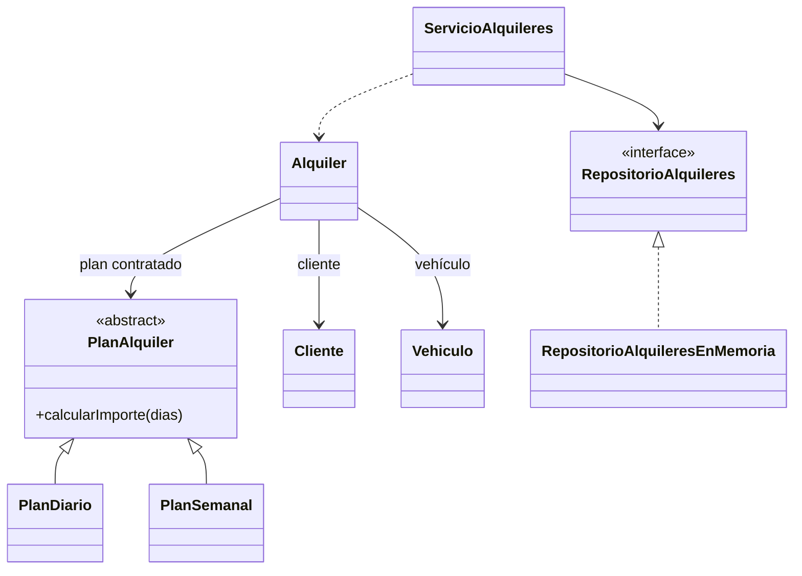

# Propuesta Inicial de Proyecto – Programación Orientada a Objetos

**Carrera:** Ingeniería de Software  
**Materia:** Programación II  
**Periodo:** Segundo Parcial / Proyecto Final  
**Estudiante(s):** Alberth Said Joseph Perez Nina  
**Fecha de entrega:** 2026-11-13

---

## 1. Datos Generales del Proyecto

| Campo | Descripción |
|---|---|
| **Nombre del proyecto:** | RutaRent – Sistema de reservas y alquiler de autos |
| **Tipo de aplicación:** | ☐ Escritorio ☐ Web ☐ Móvil ☑ Otro: Consola |
| **Lenguaje / entorno de desarrollo:** | Java 21, Visual Studio Code y Ubuntu (WSL) |
| **Repositorio Git (URL):** | https://github.com/JosephPerez725/proyecto-final-poo |
| **Uso de Inteligencia Artificial:** | ☐ No ☑ Sí (describir a continuación) |

**Si usas IA, explica brevemente cómo y en qué etapa contribuye:**

> Usé ChatGPT para explorar ideas, estudiar conceptos de POO y preparar un borrador de la propuesta. Durante el desarrollo lo usaré como tutor para resolver dudas y revisar decisiones de diseño. Yo escribiré, probaré y defenderé el código.

---

## 2. Descripción del Proyecto

### Resumen breve

> RutaRent es una aplicación de consola para el encargado de una agencia de alquiler de autos.  
> Permite reservar un vehículo para un cliente, registrar su entrega y cerrar el alquiler cuando se devuelve.  
> El sistema ayuda a evitar reservas superpuestas para el mismo auto y calcula el importe final según el plan contratado.

### Objetivos principales

1. Registrar reservas de vehículos por cliente y fechas, validando la disponibilidad del auto.
2. Registrar la entrega del vehículo y controlar los cambios de estado del alquiler.
3. Registrar la devolución y calcular el importe final aplicando el plan diario o semanal contratado.

---

## 3. Diseño Técnico y Aplicación de POO

### Principios de POO aplicados

Marca los que planeas usar:

- [x] Encapsulamiento (atributos privados y métodos públicos)
- [x] Uso de constructores
- [x] Herencia
- [x] Polimorfismo
- [x] Interfaces o clases abstractas

**Aplicación prevista.** `Alquiler` vinculará un cliente, un vehículo y el plan contratado. Sus atributos privados y sus operaciones de entrega y devolución protegerán el estado. Los constructores validarán los datos iniciales. La clase abstracta `PlanAlquiler` declarará `calcularImporte(dias)`. `PlanDiario` y `PlanSemanal` heredarán de ella y aplicarán reglas de cobro diferentes. Al cerrar el alquiler, se hará la misma llamada al plan contratado y se usará el importe que devuelva.

**Decisiones de diseño.** La consola se encargará de leer y mostrar datos, el alquiler de controlar su estado y el plan de calcular la tarifa. El servicio recibirá por constructor una implementación de `RepositorioAlquileres`, la interfaz para consultar y registrar alquileres. Esto permitirá probar el flujo con un repositorio en memoria. Las reglas rechazarán fechas inválidas, reservas superpuestas y devoluciones duplicadas antes de registrar cambios. Pasar las fechas como datos permitirá comprobar los cálculos con casos repetibles. Se reutilizará la validación común de duración y el programa se ejecutará con Java 21, sin rutas fijas.

### Persistencia de datos

- [ ] Archivos locales
- [ ] Base de datos
- [x] En memoria (temporal)
- [ ] Otro: __________

**Capa objetivo propuesta.** Lógica de negocio en Java con un menú de consola y almacenamiento en memoria. Los registros estarán disponibles durante cada ejecución. Este alcance permite demostrar el proceso completo de reserva, entrega y devolución.

**Diagrama inicial de clases**

---

## 4. Funcionalidades Principales

| Nº | Nombre de la funcionalidad | Descripción breve | Estado actual |
|---|---|---|---|
| 1 | Registrar reserva | Vincula cliente, vehículo, fechas y plan de cobro. Rechaza fechas inválidas y reservas que se crucen para el mismo vehículo. | ☑ Planeada ☐ En desarrollo |
| 2 | Registrar entrega | Registra la entrega del vehículo y cambia el estado de la reserva a alquiler activo. | ☑ Planeada ☐ En desarrollo |
| 3 | Registrar devolución | Comprueba que el alquiler esté activo, calcula el importe según el plan contratado y registra el cierre. | ☑ Planeada ☐ En desarrollo |

> *(Agrega más filas si lo necesitas.)*

---

## 5. Compromiso del Estudiante

Declaro que:

- Entiendo los criterios de evaluación establecidos en las rúbricas.
- Presentaré una demostración funcional del proyecto.
- Defenderé el código que yo mismo implementé y explicaré las clases y métodos principales.
- Si usé herramientas de IA, comprendo su funcionamiento y las adapté al contexto del proyecto.

**Firma (nombre completo):** Alberth Said Joseph Perez Nina

---

## 6. Validación del Docente *(completa el profesor)*

| Campo | Detalle |
|---|---|
| **Visto bueno del docente:** | ☐ Aprobado para desarrollar ☐ Requiere ajustes ☐ Rechazado |
| **Comentarios / Observaciones:** | |
| **Firma docente:** | |
| **Fecha de revisión:** | |

