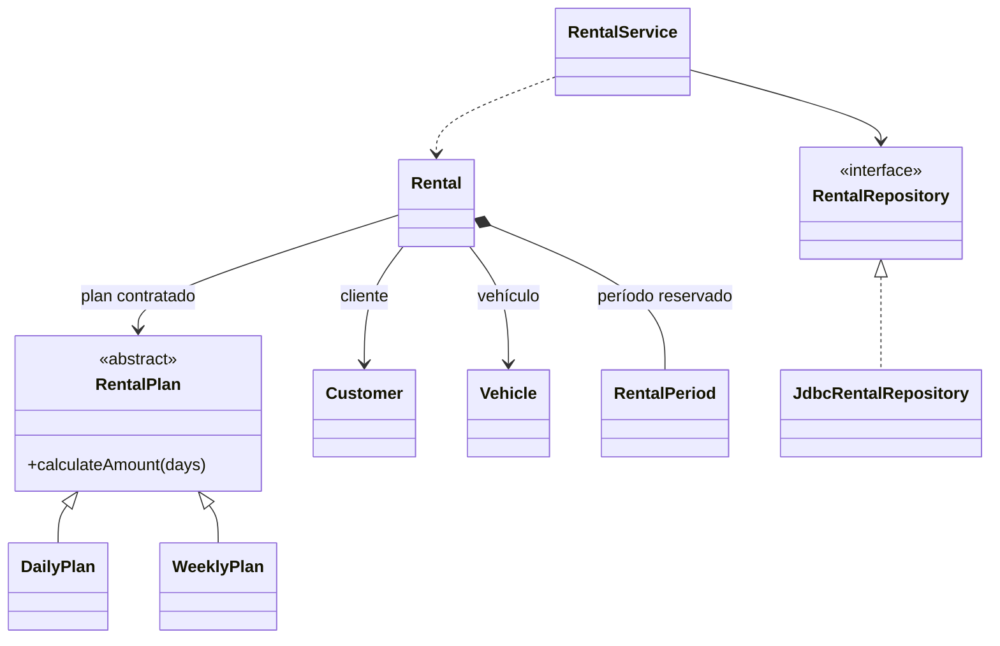

# Propuesta Inicial de Proyecto – Programación Orientada a Objetos

**Carrera:** Ingeniería de Software  
**Materia:** Programación II  
**Periodo:** Segundo Parcial / Proyecto Final  
**Estudiante(s):** Alberth Said Joseph Perez Nina  
**Fecha de entrega:** 2026-11-13

---

## 1. Datos Generales del Proyecto

| Campo | Descripción |
|---|---|
| **Nombre del proyecto:** | RutaRent – Sistema de reservas y alquiler de autos |
| **Tipo de aplicación:** | ☐ Escritorio ☑ Web ☐ Móvil ☐ Otro: __________ |
| **Lenguaje / entorno de desarrollo:** | Java 21 para el backend, HTML/CSS/JavaScript para el frontend y PostgreSQL con JDBC como opción propuesta de persistencia. Visual Studio Code y Ubuntu (WSL) para el desarrollo. |
| **Repositorio Git (URL):** | https://github.com/JosephPerez725/proyecto-final-poo |
| **Uso de Inteligencia Artificial:** | ☐ No ☑ Sí (describir a continuación) |

**Si usas IA, explica brevemente cómo y en qué etapa contribuye:**

> Usé ChatGPT para explorar ideas, estudiar conceptos de POO y preparar un borrador de la propuesta. Durante el desarrollo lo usaré como tutor para resolver dudas y revisar decisiones de diseño. Yo escribiré, probaré y defenderé el código.

---

## 2. Descripción del Proyecto

### Resumen breve

> RutaRent es una aplicación web para el encargado de una agencia de alquiler de autos.  
> Permite reservar un vehículo para un cliente, registrar su entrega y cerrar el alquiler cuando se devuelve.  
> El sistema ayuda a evitar reservas superpuestas para el mismo auto y calcula el importe final según el plan contratado.

### Objetivos principales

1. Registrar reservas de vehículos por cliente y fechas, validando la disponibilidad del auto.
2. Registrar la entrega del vehículo y controlar los cambios de estado del alquiler.
3. Registrar la devolución y calcular el importe final aplicando el plan diario o semanal contratado.

---

## 3. Diseño Técnico y Aplicación de POO

### Principios de POO aplicados

Marca los que planeas usar:

- [x] Encapsulamiento (atributos privados y métodos públicos)
- [x] Uso de constructores
- [x] Herencia
- [x] Polimorfismo
- [x] Interfaces o clases abstractas

**Aplicación prevista.** `Rental` representa cada alquiler y vincula un cliente, un vehículo, un período y el plan contratado. El constructor valida los datos iniciales. Las operaciones de entrega y devolución protegen el estado del alquiler. La clase abstracta `RentalPlan` concentrará la validación común de los días y delegará el cálculo a `DailyPlan` y `WeeklyPlan`. El cierre del alquiler invoca el cálculo a través de `RentalPlan`.

**Bajo acoplamiento.** `RentalRepository` define las operaciones para consultar y guardar alquileres. `JdbcRentalRepository` implementará esas operaciones con SQL. `RentalService` recibirá el repositorio por constructor y coordinará la consulta de disponibilidad y el registro de los cambios. La API HTTP recibirá las solicitudes del formulario y devolverá el resultado o un mensaje de validación.

**Portabilidad y accesibilidad.** La configuración de conexión se leerá desde el entorno del backend. El formulario tendrá etiquetas visibles asociadas a cada campo, navegación por teclado y mensajes de error en texto. Las comprobaciones usarán fechas conocidas para verificar cruces, transiciones de estado y ambos planes de cobro.

### Persistencia de datos

- [ ] Archivos locales
- [x] Base de datos
- [ ] En memoria (temporal)
- [ ] Otro: __________

**Capa objetivo.** Aplicación web con un formulario y una lista de alquileres, una API HTTP en Java 21 y persistencia en una base de datos relacional. La demostración recorrerá una reserva, su entrega y devolución desde el navegador. Después de reiniciar el backend se verificará que el registro permanezca en la base de datos.

**Configuración de conexión.** El backend leerá `DB_URL`, `DB_USER` y `DB_PASSWORD` de su entorno. Se documentarán los nombres de las variables y ejemplos sin credenciales reales.

**Diagrama inicial de clases**

---

## 4. Funcionalidades Principales

| Nº | Nombre de la funcionalidad | Descripción breve | Estado actual |
|---|---|---|---|
| 1 | Registrar reserva | Vincula cliente, vehículo, fechas y plan de cobro. Rechaza fechas inválidas y reservas que se crucen para el mismo vehículo. | ☑ Planeada ☐ En desarrollo |
| 2 | Registrar entrega | Registra la entrega del vehículo y cambia el estado de la reserva a alquiler activo. | ☑ Planeada ☐ En desarrollo |
| 3 | Registrar devolución | Comprueba que el alquiler esté activo, calcula el importe según el plan contratado y registra el cierre. | ☑ Planeada ☐ En desarrollo |

> *(Agrega más filas si lo necesitas.)*

---

## 5. Compromiso del Estudiante

Declaro que:

- Entiendo los criterios de evaluación establecidos en las rúbricas.
- Presentaré una demostración funcional del proyecto.
- Defenderé el código que yo mismo implementé y explicaré las clases y métodos principales.
- Si usé herramientas de IA, comprendo su funcionamiento y las adapté al contexto del proyecto.

**Firma (nombre completo):** Alberth Said Joseph Perez Nina

---

## 6. Validación del Docente *(completa el profesor)*

| Campo | Detalle |
|---|---|
| **Visto bueno del docente:** | ☐ Aprobado para desarrollar ☐ Requiere ajustes ☐ Rechazado |
| **Comentarios / Observaciones:** | |
| **Firma docente:** | |
| **Fecha de revisión:** | |

